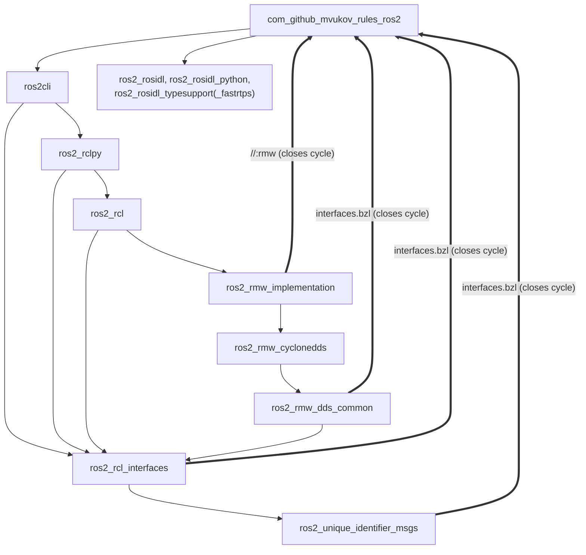
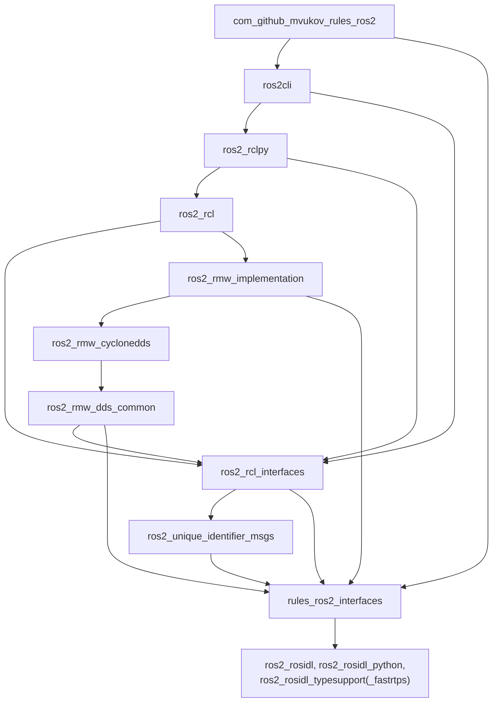

# rules_ros2_interfaces

Bazel rules that generate ROS 2 interface code (msg/srv/action → C, C++, Python, type
descriptions): `ros2_interface_library`, `ros2_c_interface_library`,
`ros2_cpp_interface_library`, `ros2_py_interface_library` and their aspects and providers.
It also holds the `//:rmw` build setting that selects the DDS implementation.

This code used to live in `com_github_mvukov_rules_ros2` (`ros2/interfaces.bzl`,
`ros2/cc_opts.bzl`). It was moved, unchanged, into its own module to break a module
dependency cycle.

## Why: the cycle

`rules_ros2` depends on `ros2cli`, because its launch, topic, service and test wrappers run the
`ros2` CLI. The low-level ROS 2 modules under `ros2cli` (`rcl_interfaces`, `rmw_dds_common`,
`unique_identifier_msgs`, `rmw_implementation`) also needed `rules_ros2`, but only for the
interface generators and the `rmw` flag. That closed a 9-module cycle:



Bzlmod tolerates the cycle, but it makes the layering impossible to follow. Every low-level
module also pulled `rules_ros2` into its graph, and through it `ros2cli` and its whole
dependency tree.

## After

`rules_ros2_interfaces` depends only on the rosidl generators. The low-level modules depend on
it, and `rules_ros2` sits on top of `ros2cli`:



Edges from other modules to the rosidl packages are left out of both graphs.

## What moved, and compatibility

| Was in `com_github_mvukov_rules_ros2` | Now | Old label still works? |
|---|---|---|
| `//ros2:interfaces.bzl` | `@rules_ros2_interfaces//ros2:interfaces.bzl` | Yes: the old file re-exports every symbol |
| `//ros2:cc_opts.bzl` | `@rules_ros2_interfaces//ros2:cc_opts.bzl` | Yes: re-export |
| `//:rmw` (string_flag) | `@rules_ros2_interfaces//:rmw` | Yes: `alias`, including `--@com_github_mvukov_rules_ros2//:rmw=zenoh` on the command line |
| `//:numpy`, `//:numpy_lib` | `@rules_ros2_interfaces//:numpy`, `//:numpy_lib` | Yes: `alias` |

Providers are re-exported, not copied, so targets built through either path interoperate.

Rule for new modules: anything that `ros2cli` depends on, directly or transitively, must load
`@rules_ros2_interfaces` and must not depend on `com_github_mvukov_rules_ros2`. Modules above
`ros2cli` may use either.

## Usage

```starlark
bazel_dep(name = "rules_ros2_interfaces", version = "0.1.0")
```

```starlark
load("@rules_ros2_interfaces//ros2:interfaces.bzl", "ros2_interface_library")

ros2_interface_library(
    name = "my_msgs",
    srcs = glob(["msg/*.msg"]),
    deps = ["@ros2_rcl_interfaces//:builtin_interfaces"],
)
```

The Python generator needs numpy. This module brings its own pip hub
(`rules_ros2_interfaces_pip_deps`, numpy only). Regenerate the lock with
`bazel run //:python_requirements.update`.

## License

Apache 2.0, same as rules_ros2, which this code comes from. See [LICENSE](LICENSE).
